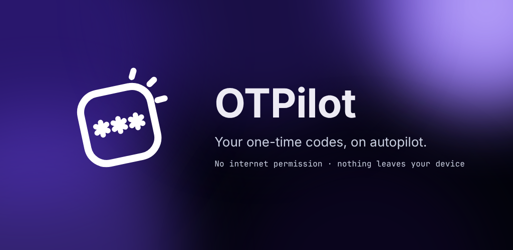

# OTPilot

Your one-time codes, on autopilot.

OTPilot watches incoming SMS and notifications, finds the verification code,
and puts it on your clipboard before you even open the message.
No internet permission. Nothing leaves your device.

## Why OTPilot

- **Root-aware.** On rooted devices, OTPilot grants itself access to the
  sensitive notifications Android 15+ hides from third-party apps, and
  re-applies it after every boot. No ADB, no PC.
- **Honest status.** If a permission it depends on is revoked, OTPilot tells
  you, instead of silently failing.
- **Smarter extraction.** Multi-pass detection: keyword-anchored first,
  then a context fallback for messages where the code comes a little after
  the keyword ("use the verification code below ... 316974"). The fallback
  only trusts a bare "code" when the words around it make it a sign-in code,
  so "VS Code" plus a ZIP code in an email footer is not copied.
- **Regression-tested on real messages.** Every release must pass a growing
  corpus of real-world SMS and email codes (EN, PT-BR, ES).

## Status

OTPilot is in early development. The core detection engine is inherited
from upstream and already works; the features above are rolling out in
stages:

- [x] Rebrand and real-world regression corpus
- [x] Root-aware permission handling and status warnings
- [x] Context fallback extraction
- [x] New interface (tvnclr-ui): light, dark and AMOLED themes, 8 accent colors or Material You
- [x] New icon, with a themed (monochrome) version that works in icon packs

## Requirements

- Android 7.0+
- Root (KernelSU/KowSU, Magisk) recommended. Without root, OTPilot still
  works, but Android 15+ will hide some notifications from it.

## Upgrading from 1.0.x

Starting with 1.1.0 the package name is `dev.tvnclr.otpilot` (it was
`tvnclr.flightdeck.otpilot`). Android treats it as a different app, so 1.1.0
installs next to 1.0.x instead of updating it:

1. Install 1.1.0 and go through the setup again (permissions, settings).
2. Uninstall the old OTPilot. Its history and settings are not carried over.

If an automation app (Tasker, MacroDroid...) listens for OTPilot's broadcast,
the action is now `dev.tvnclr.otpilot.actions.code_detected`.

## Privacy

OTPilot has no network permission, so nothing it reads ever leaves your
device. Detected codes are kept in a local history on the device; in
Settings you can turn the history off, or have codes replaced with zeros
before they are saved.

## License

AGPL-3.0. See LICENSE and NOTICE.
