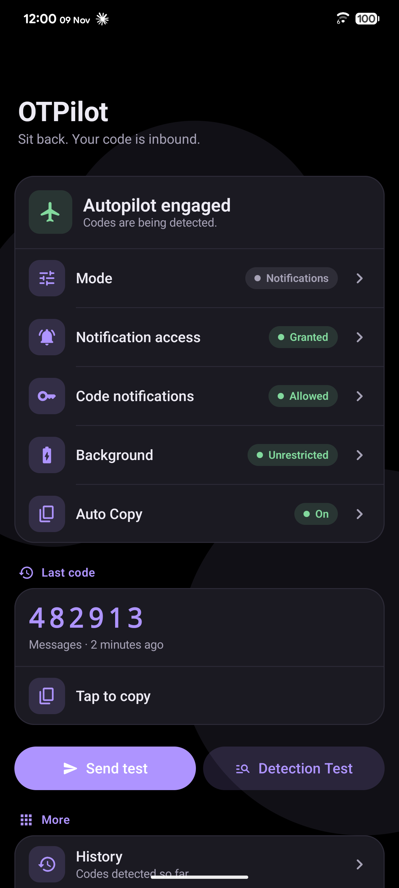
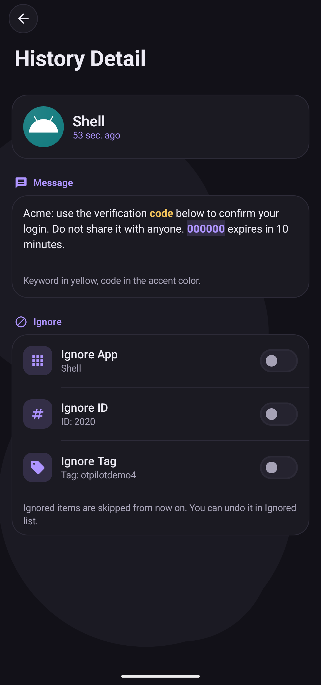
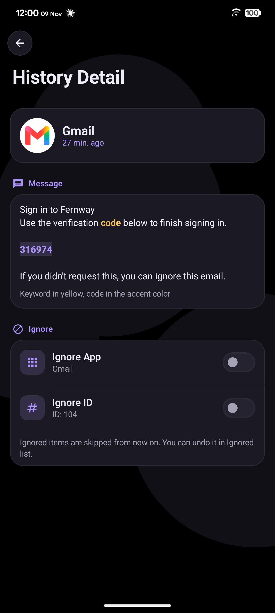
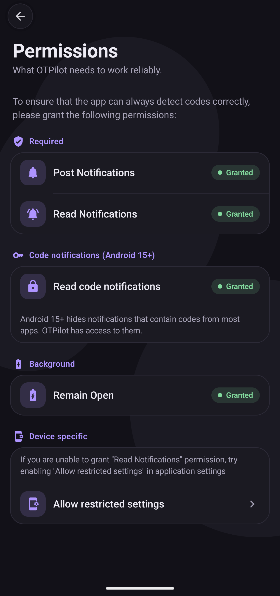
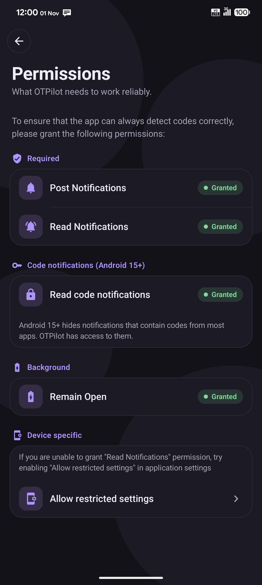
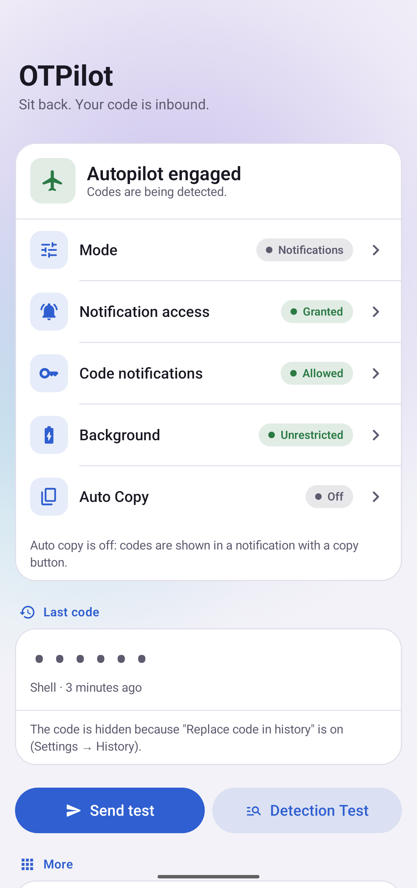

# OTPilot

Your one-time codes, on autopilot.

OTPilot watches incoming SMS and notifications, finds the verification code,
and puts it on your clipboard before you even open the message.
No internet permission. Nothing leaves your device.

## Screenshots

  
  
  

  
  
  

## Why OTPilot

- **Root-aware.** On rooted devices, OTPilot grants itself access to the
  sensitive notifications Android 15+ hides from third-party apps, and
  re-applies it after every boot. No ADB, no PC.
- **Honest status.** If a permission it depends on is revoked, OTPilot tells
  you, instead of silently failing.
- **Smarter extraction.** Multi-pass detection: keyword-anchored first,
  then context fallback for messages where the code is far from the keyword.
- **Regression-tested on real messages.** Every release must pass a growing
  corpus of real-world SMS and email codes (EN, PT-BR, ES).

## Status

OTPilot is in early development. The core detection engine is inherited
from upstream and already works; the features above are rolling out in
stages:

- [x] Rebrand and real-world regression corpus
- [x] Root-aware permission handling and status warnings
- [x] Context fallback extraction
- [x] New interface (Flightdeck UI): light, dark and AMOLED themes, 8 accent colors or Material You

## Requirements

- Android 8.0+
- Root (KernelSU/KowSU, Magisk) recommended. Without root, OTPilot still
  works, but Android 15+ will hide some notifications from it.

## Privacy

OTPilot has no network permission, so nothing it reads ever leaves your
device. Detected codes are kept in a local history on the device; in
Settings you can turn the history off, or have codes replaced with zeros
before they are saved.

## License

AGPL-3.0. See LICENSE and NOTICE.
